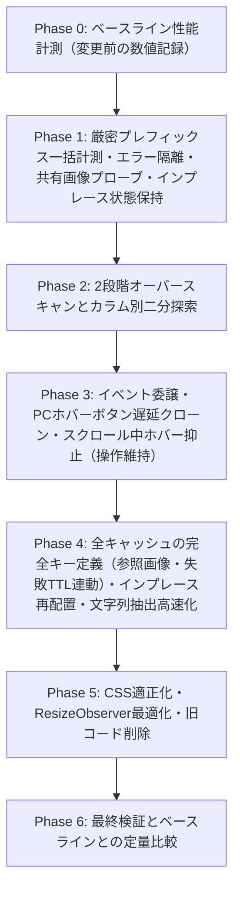

# PC環境における大量カード表示時のスクロール・動作軽量化 調査報告書および実装計画（第7版）

## 1. 背景と目的

- **課題**: スマートフォンやiPadでは軽快に動作するが、PC（デスクトップ版Obsidian）で大量のカードを表示した際、スクロール時のカクつき（ジャンク）や全体的な動作の重さが発生する。
- **目的**: [REQUIREMENTS.md](REQUIREMENTS.md) および [README.md](file:///C:/Users/kyoma/orca/workspaces/keep-bases-view/main-2/README.md) に定義された既存仕様・見た目・機能を一切損なうことなく、PC環境での大量カード表示・スクロール・リサイズ性能を軽量化する。
- **最重要の品質要件（合意事項）**:
  1. **位置ズレの100%防止**: 一度位置が確定して画面にマウントされたカードが、後から画像や `.base` の読み込み完了、あるいは先行カードの遅延計測によって再計算され、画面上で再度動く（ガタつく・列が変わる・位置ズレする）ような挙動を100%防止すること。
  2. **本文内画像の見た目変化の100%防止**: 本文内画像（`.kg-lite-image`）をタイムアウトで16:9等の固定枠に縮小・切り抜きするのではなく、読み込み完了（`load` / `error`）まで待ってから本来の自然な縦横比（`width: 100%; height: auto`）で高さを確定させることで、「位置ズレ」も「通信速度による見た目の変化」も100%防ぐこと。
  3. **深い位置への移動時も厳密プレフィックス計測を維持**: コールドキャッシュ時に深い位置（例: 数千枚目）へ一気にジャンプした場合でも、位置の不変性を最優先して先頭からの厳密プレフィックス計測を完了させてから表示し、計測待機中はローディングインジケータを表示すること。

---

## 2. レビュー指摘事項（第1回〜第5回）の反映と確定仕様

コード照合レビュー（`gpt6.1sol` 第1回〜第5回）の指摘事項およびユーザーとの認識合わせに基づき、以下の通り設計仕様を確定した。

| 指摘項目 | レビュー指摘の内容 | 確定した設計仕様 |
| --- | --- | --- |
| **① 厳密プレフィックス計測における深い位置への移動・復元時の挙動と条件別目標時間** | 先頭から計測する設計ではコールドキャッシュでの深い位置への移動に時間がかかる。また未キャッシュ画像の待機時間・同時取得数上限と到達目標時間の関係を明記すべき。 | **先頭からの厳密プレフィックス計測＋共有プローブによる先行並列プリロード＋条件別目標時間の明文化（5.1節 1-1, 1-3）**: ・位置ズレゼロを最優先とし、深い位置への移動時も先頭（`Pinned` 全件 → `Others` `0 .. i`）から順にバッチ計測（1バッチ32〜48枚）を進める。 ・**条件A（ウォームキャッシュ時 / 通常のカード開閉からのスクロール復帰等）**: 先行カードは既にキャッシュ済みのため、ファイルI/Oなしで **1〜2フレーム（目標: 32ms以内）** に復元完了する。 ・**条件B（コールドキャッシュ・テキストおよびローカルVault画像または画像寸法キャッシュ済みの場合）**: 1,000枚先で約0.3〜1.0秒、5,000枚先で約1.5〜4.0秒を目安とする。 ・**条件C（コールドキャッシュ・未キャッシュの外部URL本文画像を含む場合）**: 同時取得数上限（`_maxConcurrentImageProbes = 8`）付きの共有プローブで先行プリロードを行う。1プローブあたりの無応答タイムアウト上限は `3,000ms`（3秒）とし、未キャッシュ外部画像が $K$ 枚ある場合の理論最大待機時間は $\lceil K / 8 \rceil \times 3\text{秒}$ となるため、画像を含むデータセットでの実待機時間は Phase 0 / Phase 6 の実測検証対象とする。 |
| **② 画像プリロードとバッチ計測間の状態共有、および失敗TTLとカードキャッシュの連動** | 先読みと計測バッチで進行中Promise・失敗結果を共有する必要がある。また、画像失敗の60秒TTLが切れても `_cardLayoutCache` に「画像なし」が永久に残ると再試行されない一方、スクロール中に再計測されると位置がズレる。 | **統合画像プローブ機構＋失敗TTLの `_cardLayoutCache` 連動（表示中の位置不変維持）（5.1節 1-3, 1-5, 5.4節 4-1, 4-2）**: ・プリロードとバッチ計測の双方が同一の `_probeImageDimensions(imageSpec)` を呼び出し、**進行中の `Promise`（`_inFlightImageProbes`）および成功/失敗結果（`_imageDimensionCache`）を共有**する（同時取得上限 `_maxConcurrentImageProbes = 8`）。 ・ロード失敗・タイムアウト時は `_imageDimensionCache` に `{ status: "failed", expiresAt: now + 60000 }` を保存するとともに、**その失敗画像を含む `_cardLayoutCache` エントリにも同じ `expiresAt`（60秒期限）を設定**する。 ・**再試行のタイミングと位置安定性の両立**: 表示中・スクロール中（同一 `_layoutEpoch` かつ同一レンダーサイクル内）は、`expiresAt` を過ぎても `section.items` 上の確定済み `item.height`・`item.measured = true` を維持して**その場での高さ変更・位置ズレを一切起こさない**。次回ビューを開き直した時やデータ更新（`render()` / `onDataUpdated()`）・エポック更新時に `_cardLayoutCache` の `expiresAt` 期限切れを判定し、期限切れであれば `_cardLayoutCache` と `_imageDimensionCache` の失敗エントリを破棄してプローブを再試行する。 |
| **③ 画像の追加・差し替え・削除・リネーム時におけるカード高さキャッシュの連動失効** | ノート自体を編集せずに参照先の画像ファイルを更新・削除・**新規追加（リンク切れ解消）**した場合にもカードキャッシュを失効させて再描画する必要がある（監視イベントに `create` も必要）。 | **参照画像のファイル署名組み込み＋Vaultの `create / modify / delete / rename` 監視（5.4節 4-1, 4-2）**: 1. `item.entrySignature` に、カバー画像の解決先 `TFile` 署名および `metadataCache.getFileCache(file)?.embeds` 内の全埋め込み画像ファイルの解決先 `TFile` 署名（`path:mtime:size`、未解決時は `missing:link`）を含める。 2. 標準Markdown画像構文 `` 等も含め、計測時に各画像のリンク文字列 `raw`・解決状態（`file:path:mtime:size` または `missing:raw`）を `imageLocks` に記録し、`_isImageLocksValid(imageLocks, cardFilePath)` で再解決・照合する（以前はリンク切れ `missing:raw` だった画像が後からVaultに追加されて `TFile` に解決できるようになった場合も不一致を検知して失効する）。 3. `workspace.onLayoutReady()` 後に Vault の **`create` / `modify` / `delete` / `rename` の4イベントすべて**を監視し、画像ファイルが追加・更新・削除・リネームされた際は該当キャッシュを失効させて `_debouncedRender()` をトリガーする。 |
| **④ ファイル読み込み失敗時のフォールバックとプレフィックス計測の継続規則** | 先行カード1枚の `vault.cachedRead` が失敗すると、後続すべての表示が止まる恐れがある。 | **カード単位のエラー隔離（Fault-Isolated Best-Effort Measurement）（5.1節 1-2）**: ・バッチ内の各カードの `vault.cachedRead` とパースはカード単位の `try / catch` で保護し、失敗時は「本文プレビューなし（`kg-no-preview`）」の代替表示として高さを確定して `section.measuredPrefixEnd` を確実に進める（失敗結果は永続キャッシュには保存しない）。 |
| **⑤ キャッシュキーの完全定義・インプレース状態保持・エポック競合保護** | 共通設定・個別署名・CSS変更世代番号・リサイズ競合保護・LRU削除後の高さ維持の厳密化。 | **3種キャッシュの完全キー定義、`section.items` のインプレース保持、`_cssGeneration`、およびエポック不一致時の即時破棄規則（Strict Epoch Abort Rule）を適用（5.1節 1-2, 1-5, 5.4節 4-1, 4-2）**。 |
| **⑥ 本文内画像の実寸縦横比100%維持とスクロール中ホバー抑止の操作維持** | 通信速度による画像の見た目変化防止、およびスクロール停止直後のクリック維持と静止カーソルでのボタン復帰。 | **16:9縮小フォールバックなしの完全実寸確定（5.1節 1-3）**、および **`pointer-events: none` 不使用＋停止時 `elementFromPoint` によるホバーボタン即時復帰（5.3節 3-3）**。 |

---

## 3. なぜスマホ・iPadでは軽く、PCだと重くなるのか？（根本原因の比較分析）

現行の [main.js](file:///C:/Users/kyoma/orca/workspaces/keep-bases-view/main-2/main.js) と [styles.css](file:///C:/Users/kyoma/orca/workspaces/keep-bases-view/main-2/styles.css) において、PC環境で特に負荷が増幅される**4つの構造的要因**が存在する。

| 要因 | スマホ / iPad | PC (Desktop) | PCで発生する現象 |
| --- | --- | --- | --- |
| **① カラム数と固定オーバースキャン (`_virtualOverscan = 2600`) の相乗効果** | 1〜2列（スマホ）、3〜4列（iPad）。縦約6,200pxの仮想ウィンドウ内の同時マウント数は比較的少ない。 | ワイド画面では **6〜10列以上**。同じ縦約6,200px（上下2,600px＋画面高）のウィンドウ内に多数のカードが同時マウントされる。 | 1pxスクロールするごとに通過・生成・破棄されるカード枚数がモバイルの数倍に達し、1フレーム（16.6ms）の処理時間を超過しやすくなる。 |
| **② スクロール中の静止マウスカーソルによる `mouseover` / `:hover` 連鎖** | タッチスクロール中はポインタのホバー判定や `mouseover` イベントが連続発火しない。 | マウスカーソルを画面上に置いたままホイールスクロールすると、**カーソル下を通過するカード**に対して毎フレーム `:hover` 再計算と `mouseover` イベントが発火する。 | [main.js:1545-1556](file:///C:/Users/kyoma/orca/workspaces/keep-bases-view/main-2/main.js#L1545-L1556) で通過カードに対し `workspace.trigger("hover-link")` が発火し、さらに [styles.css:171-174](file:///C:/Users/kyoma/orca/workspaces/keep-bases-view/main-2/styles.css#L171-L174)、[styles.css:207-289](file:///C:/Users/kyoma/orca/workspaces/keep-bases-view/main-2/styles.css#L207-L289) の `box-shadow` とアクションボタンの `opacity` トランジションが次々に発生する。 |
| **③ PC専用のホバーボタン・SVGアイコン・イベントリスナーの常時生成** | `!obsidian.Platform.isMobile` が偽のため、未ピン留めカードにはボタンもSVGも生成されない（[main.js:1363](file:///C:/Users/kyoma/orca/workspaces/keep-bases-view/main-2/main.js#L1363), [main.js:1476](file:///C:/Users/kyoma/orca/workspaces/keep-bases-view/main-2/main.js#L1476)）。 | すべてのカード生成時に **3つの `<button>` と 3つの `<svg>` アイコン（`obsidian.setIcon`）および計6個のイベントリスナー** が無条件に生成される（[main.js:1476-1556](file:///C:/Users/kyoma/orca/workspaces/keep-bases-view/main-2/main.js#L1476-L1556)）。 | ホバーしていない大多数のカードおよびオフスクリーン計測用の使い捨てDOMでも毎回ボタン・SVG・イベントリスナーが生成・破棄され続ける。 |
| **④ 常時 `will-change: transform` の指定** | モバイル環境では同時マウント枚数自体が少ない。 | `.kg-virtual-card` に常時 `will-change: transform`（[styles.css:121](file:///C:/Users/kyoma/orca/workspaces/keep-bases-view/main-2/styles.css#L121)）が指定されており、多数のマウント済みカードに対してコンポジタ層のオーバーヘッドを増やす要因となる。 | スクロール中は各カードの `transform` 自体は変化しないため、リサイズアニメーション時以外の常時指定は不要な負荷となる。 |

---

## 4. コードベース全体のボトルネック詳細分析

### 4.1 【最重要】スクロール中の同期レイアウトスラッシング（Forced Synchronous Layout）の連鎖
- **該当箇所**: [`_renderVirtualWindow`](file:///C:/Users/kyoma/orca/workspaces/keep-bases-view/main-2/main.js#L529-L577) → [`_mountVirtualCard`](file:///C:/Users/kyoma/orca/workspaces/keep-bases-view/main-2/main.js#L579-L592) → [`_queuePreview`](file:///C:/Users/kyoma/orca/workspaces/keep-bases-view/main-2/main.js#L1149-L1155) → [`_processPreviewQueue`](file:///C:/Users/kyoma/orca/workspaces/keep-bases-view/main-2/main.js#L1166-L1200) → [`_refreshPreviewQueue`](file:///C:/Users/kyoma/orca/workspaces/keep-bases-view/main-2/main.js#L1202-L1224)
- **問題の詳細**:
  1. `_renderVirtualWindow()` 内でカードをマウントする際、[`_mountVirtualCard` (L590)](file:///C:/Users/kyoma/orca/workspaces/keep-bases-view/main-2/main.js#L590) が無条件に `this._queuePreview(cardEl, true)`（`priority = true`）を呼んでいる。
  2. `priority = true` のため、**1枚 `appendChild`（DOM書き込み）する直後に毎回同期的に `_processPreviewQueue()` → `_refreshPreviewQueue()` が実行される**。
  3. `_refreshPreviewQueue()` は先頭（[L1204](file:///C:/Users/kyoma/orca/workspaces/keep-bases-view/main-2/main.js#L1204)）で `this._scrollEl.getBoundingClientRect()`、さらに `_getPreviewQueueScore()`（[L1229](file:///C:/Users/kyoma/orca/workspaces/keep-bases-view/main-2/main.js#L1229)）で `cardEl.parentElement.offsetTop` や `scrollTop` / `clientHeight` を読み取る（**DOM読み取り**）。
  4. その結果、1フレームに複数枚のカードが仮想ウィンドウに入ると、**1回のスクロールフレーム内で「DOM書き込み → 強制同期レイアウト（Reflow）＋キュー全件ソート」がカード枚数分連続で繰り返される**。
  5. さらに、`section.items` のループ先頭は `rootTop - 2600px`（画面上方のオーバースキャン領域）であるため、画面内にある `priorityCards`（L576）がキューに入る前に、画面外カードのロードで `_activePreviewLoads`（上限2）が埋まってしまう。

### 4.2 【最重要】オフスクリーン計測 (`_measureVirtualItem`) における二重生成・二重レンダリング・毎枚の全体再レイアウト
- **該当箇所**: [`_measureVirtualItem`](file:///C:/Users/kyoma/orca/workspaces/keep-bases-view/main-2/main.js#L624-L664), [`_measureTightCardHeight`](file:///C:/Users/kyoma/orca/workspaces/keep-bases-view/main-2/main.js#L672-L689)
- **問題の詳細**:
  1. **カードDOMとプレビューの二重生成**:
     - `_measureVirtualItem` で `_createCard` を呼び、`_loadCardBody` でファイルを読み込んで軽量MarkdownプレビューDOMを構築し、高さを計測した直後に `finally { cardEl.remove(); }`（[L662](file:///C:/Users/kyoma/orca/workspaces/keep-bases-view/main-2/main.js#L662)）で**完成したDOMを破棄**している。
     - その直前（[L659-L660](file:///C:/Users/kyoma/orca/workspaces/keep-bases-view/main-2/main.js#L659-L660)）に呼ばれる `_renderVirtualWindow()` 内の `_mountVirtualCard()` で、**同じカードの `_createCard` をもう一度ゼロから実行**し（`bodyEl` は `display: none` の空状態）、再度 `_queuePreview` に入れて非同期で `_loadCardBody`（Markdownパース＋DOM構築）をやり直している。
  2. **1枚計測するごとに全カードのレイアウト再計算 (`_layoutVirtualSections`) を実行**:
     - `_measureVirtualItem` が1枚完了するたびに `this._layoutVirtualSections()` と `this._renderVirtualWindow()` を毎回呼んでいる（[L659-L660](file:///C:/Users/kyoma/orca/workspaces/keep-bases-view/main-2/main.js#L659-L660)）。
  3. **`_measureTightCardHeight` の過剰な `getComputedStyle` / `getBoundingClientRect`**:
     - 全子要素に対して `getComputedStyle(child)` と `child.getBoundingClientRect()` を回している（[L679-L685](file:///C:/Users/kyoma/orca/workspaces/keep-bases-view/main-2/main.js#L679-L685)）。

### 4.3 【高】カバー画像 (`imageProperty`) と `.base` 埋め込みの不要な計測待機
- **該当箇所**: [`_measureVirtualItem` (L645-L652)](file:///C:/Users/kyoma/orca/workspaces/keep-bases-view/main-2/main.js#L645-L652), [styles.css:292-314](file:///C:/Users/kyoma/orca/workspaces/keep-bases-view/main-2/styles.css#L292-L314), [styles.css:640-658](file:///C:/Users/kyoma/orca/workspaces/keep-bases-view/main-2/styles.css#L640-L658)
- **問題の詳細**:
  - カバー画像枠 `.kg-card-cover` は CSS で `aspect-ratio: 16 / 9; max-height: 180px;` が指定されており、画像の読み込み完了前でもボックスの高さは確定している。
  - `.base` 埋め込みも CSS で `height: var(--kg-base-preview-height, 150px);` に固定されており、プレースホルダー（`.kg-base-placeholder`）と実埋め込みで高さは変わらない。
  - しかし `_measureVirtualItem` ではカバー画像の `` ロードや `.base` の重い `MarkdownRenderer.render` 完了＋`requestAnimationFrame` 2回待ちを行っており、計測キューをブロックしている。

### 4.4 【高】`_layoutVirtualSections()` の毎回全件再生成とキャッシュキーの不備
- **該当箇所**: [`_layoutVirtualSections` (L427-L481)](file:///C:/Users/kyoma/orca/workspaces/keep-bases-view/main-2/main.js#L427-L481), [`_getVirtualHeightKey` (L725-L740)](file:///C:/Users/kyoma/orca/workspaces/keep-bases-view/main-2/main.js#L725-L740), [`_estimateCardHeight` (L756-L780)](file:///C:/Users/kyoma/orca/workspaces/keep-bases-view/main-2/main.js#L756-L780)
- **問題の詳細**:
  1. `_layoutVirtualSections()` が呼ばれるたびに `section.entries.map(...)` で全アイテム配列を新規生成し、キャッシュから漏れたカードを推定高さ（`measured: false`）へ戻してしまう。
  2. `_getVirtualHeightKey` が実際の描画幅 `this._virtual.cardWidth` ではなく設定値 `this.currentCardWidth` を参照しており、またテーマ・CSS変更やカード毎のプロパティ値変化・参照画像の更新を網羅できていない。
  3. 未計測カードに対する `_estimateCardHeight` がレイアウト計算のたびに `entry.getValue(...)` を全プロパティ分呼び出している。

### 4.5 【高】大量カード時（1,000枚超 / 500枚超）のキャッシュ蒸発
- **該当箇所**: [`_setCachedVirtualHeight` (L746-L754)](file:///C:/Users/kyoma/orca/workspaces/keep-bases-view/main-2/main.js#L746-L754), [`_getPreviewSource` (L1891-L1906)](file:///C:/Users/kyoma/orca/workspaces/keep-bases-view/main-2/main.js#L1891-L1906)
- **問題の詳細**:
  - `_cardHeightCache` の上限が `1000`、`_previewSourceCache` の上限が `500`（かつ単純FIFO削除）であるため、1,000枚超のビューで `_layoutVirtualSections()` が全エントリを走査すると先頭側のキャッシュが押し出されて消去され、スクロールで戻った際に再計測とレイアウト変動が発生する。

### 4.6 【中〜高】毎スクロールフレームの `_renderVirtualWindow()` における不要なDOM読み取りと線形走査
- **該当箇所**: [`_renderVirtualWindow` (L529-L577)](file:///C:/Users/kyoma/orca/workspaces/keep-bases-view/main-2/main.js#L529-L577)
- **問題の詳細**:
  1. 毎スクロールフレームの先頭で `this._ensureVirtualLayoutFresh()` → `this._getVirtualContentWidth()` → `this._contentEl.getBoundingClientRect().width` を呼んでいる。
  2. `section.gridEl.offsetTop` を毎フレームDOMから読み取っている。
  3. `for (const item of section.items)` で全カードを線形走査している。
  4. 既にマウント済みで座標も変わっていないカードに対しても、毎フレーム `_positionVirtualCard()` と `_queuePreview()` を呼んでいる。
  5. アンマウント処理（[L570](file:///C:/Users/kyoma/orca/workspaces/keep-bases-view/main-2/main.js#L570)）で、外れたカード1枚ごとに `this._previewQueue = this._previewQueue.filter(item => item !== cardEl)` を実行している。

### 4.7 【中】`ResizeObserver` の過剰発火とリサイズ時の画面外アニメーション生成
- **該当箇所**: [`constructor` (L163-L174)](file:///C:/Users/kyoma/orca/workspaces/keep-bases-view/main-2/main.js#L163-L174), [`_scheduleVirtualRelayoutChecks` (L516-L527)](file:///C:/Users/kyoma/orca/workspaces/keep-bases-view/main-2/main.js#L516-L527), [`_animateResizeLayout` (L982-L1029)](file:///C:/Users/kyoma/orca/workspaces/keep-bases-view/main-2/main.js#L982-L1029)
- **問題の詳細**:
  1. `this._resizeObserver.observe(this._contentEl)` により、カード計測でグリッドの**高さ**が変わるたびに `ResizeObserver` が発火している。
  2. `_scheduleVirtualRelayoutChecks()` が初回レンダー後に無条件で4回 `_renderVirtualWindow()` を再実行している。
  3. `_animateResizeLayout()` が画面外のオーバースキャン領域にあるカードにまで `cardEl.animate(...)` を発行している。

---

## 5. 実装計画（フェーズ別詳細仕様）

---

### Phase 0: 変更前のベースライン性能計測

実装に着手する前（および各フェーズ完了後）に、`_perfLog`（設定の `Enable performance logging`）を拡張して以下の指標を同一条件で記録・比較できるようにする。
- **計測指標**:
  1. 初回レンダーおよびバッチ計測の総所要時間（`ms`）とレイアウト再計算回数
  2. コールドキャッシュおよびウォームキャッシュでの深いスクロール位置への到達・復元時間（`ms`、テキストのみの場合／画像を多数含む場合）
  3. スクロール中の `_renderVirtualWindow` 1フレームあたり所要時間（平均 / 最大 `ms`）
  4. 同時マウントされている `.kg-virtual-card` 枚数および `.kg-container` 配下の総DOMノード数
  5. ウィンドウ/サイドバーリサイズ時の `_animateResizeLayout` 所要時間（`ms`）

---

### Phase 1: 厳密プレフィックス一括計測・エラー隔離・共有画像プローブ・インプレース状態保持（効果：極大）

#### 1-1. 先頭からの厳密プレフィックス計測ルールと深い位置への移動・復元設計
- **依存関係の不変条件**:
  - Shortest-column Masonryでは、あるカードの配置 `(x, y, column)` は同一セクション内のそれ以前の全カード（`0 .. i-1`）の高さ、および先行する `Pinned` セクション全体の高さに依存する。
  - **「先行する未計測カードが1枚でも残っているカードは画面へマウントしない」** という厳密なプレフィックス規則を適用する：
    1. `Pinned` セクションが存在する場合、`Pinned` 内の全カード（`0 .. Pinned.length - 1`）が計測完了（`item.measured === true`）して `Pinned` セクションの高さが確定するまで、`Others` セクションのカードはマウントしない。
    2. 各セクション内で、先頭から連続して計測が完了している末尾インデックス `section.measuredPrefixEnd`（初期値 `-1`）を管理し、`item.index <= section.measuredPrefixEnd` を満たすカードのみをマウント対象とする。
    3. ユーザーの現在スクロール位置（または復元対象 `scrollTop`）＋ `measureOverscan` までの範囲に未計測カードがある場合、計測キューは必ず **`Pinned` の未計測先頭 → `Others` の未計測先頭（`measuredPrefixEnd + 1`）から順番に** バッチ計測を進める。
- **深い位置へのジャンプ・スクロール復元時の挙動と条件別目標時間**:
  - **条件A：ウォームキャッシュ時（通常のカードクリック→戻る等のスクロール復元）**:
    - 戻る前の閲覧時に通過した先行カードはすべて `_cardLayoutCache` にキャッシュされているため、`_renderVirtual()` 初期化時にキャッシュから即座に `item.measured = true`・`item.height` が復元され、ファイルI/Oやオフスクリーン計測なしで **1〜2フレーム以内（目標: 32ms以内）** に元のスクロール位置へ復帰する。
  - **条件B：コールドキャッシュ・テキスト／ローカルVault画像／画像寸法キャッシュ済みの場合**:
    - 位置ズレゼロを保証するため、先頭から対象位置までのバッチ計測（1バッチ 32〜48枚）を順次実行する。
    - 目標到達時間の目安：1,000枚先で約0.3〜1.0秒、5,000枚先で約1.5〜4.0秒。
  - **条件C：コールドキャッシュ・未キャッシュの外部ネットワーク画像（`http(s)://`）を先行範囲に含む場合**:
    - 1-3節の共有画像プローブ機構（同時取得上限 `M = 8`、1プローブあたりの無応答タイムアウト上限 `3,000ms`）により先行プリロードを行う。
    - 先行範囲内に未キャッシュの外部画像が $K$ 枚含まれる場合、すべてが無応答サーバーであった場合の理論上限は $\lceil K / 8 \rceil \times 3\text{秒}$ となり、実際の外部画像混在時の到達時間は Phase 0 / Phase 6 での実測比較対象とする。
  - **待機中の表示**:
    - スクロール復元中（`restoring === true`）は `.kg-restoring-scroll` によりコンテンツを非表示とし、対象位置までのプレフィックス計測が完了して正確な `scrollTop` が確定した時点で表示する（`onClose` または新トークン発行時は確実に解除する）。
    - 通常閲覧中にユーザーが未計測の深い位置へスクロールした場合は、Masonry座標に一切影響しない固定オーバーレイ要素（`.kg-measuring-status`: `"Measuring cards... (完了数 / 目標数)"`）を表示し、`measuredPrefixEnd` が現在表示域に到達した瞬間にオーバーレイを消してカードを一括マウントする。

#### 1-2. バッチ一括計測パイプライン・カード単位のエラー隔離・エポック競合保護
- **レイアウトエポック (`this._layoutEpoch`) の定義**:
  - `this._renderToken`、実カード幅 `this._virtual.cardWidth`、設定キー `this._layoutConfigKey`、CSS世代番号 `this.plugin._cssGeneration` のいずれかが変化するたびに `++this._layoutEpoch` をインクリメントする。
- **バッチ計測フロー（1バッチ最大 32〜48枚）**:
  1. **エポック記録**: バッチ開始時に `const startEpoch = this._layoutEpoch;` および `const startToken = this._renderToken;` を記録する。
  2. **本文の並列取得とカード単位のエラー隔離（Fault-Isolated Best-Effort Read）**:
     - バッチ内の各カードについて `vault.cachedRead(file)` から先頭25行・1000文字を並列取得する。
     - **カード単位の失敗処理規則**:
       - 各カードの `_getPreviewSource(file)` および軽量パース処理を個別の `try / catch` で保護する（1枚の失敗でバッチ全体が reject されないようにする）。
       - 万一特定のカードで `vault.cachedRead` の失敗（ファイル削除・ロック・文字コード異常等）やパース例外が発生した場合は、そのカードを **「本文プレビューなし（`markdown: null, hasPreview: false, readFailed: true` → `.kg-no-preview` クラス付与）」の代替表示カード** として扱い、タイトル・カバー・プロパティ・タグのみで `_measureEl` に追加して高さを確定させる。
       - これにより、先行カード1枚のファイル読み込み失敗で `measuredPrefixEnd` の進行が止まることを100%防ぐ。
       - なお、`readFailed: true` となったカードは現在のレンダーサイクルの `item` 上でのみ `item.measured = true` とし、永続キャッシュ（`_rawPreviewTextCache` および `_cardLayoutCache`）には保存しないことで、後のデータ更新時に再試行できるようにする。
     - 取得完了直後に **`if (this._renderToken !== startToken || this._layoutEpoch !== startEpoch) return;` で整合性を検証**し、不一致なら即座に中断して新エポックでの再スケジュールに委ねる。
  3. **本文内画像の共有プローブ解決（1-3節参照）**:
     - バッチ内のカードに含まれるすべての本文内画像について、共有画像プローブ `_probeImageDimensions(imageSpec)` を並列待機し、各画像の確定状態（成功時は `{ status: "ok", naturalWidth, naturalHeight }`、失敗/タイムアウト時は `{ status: "failed", expiresAt }`）を取得する。
     - 待機完了直後に **`if (this._renderToken !== startToken || this._layoutEpoch !== startEpoch) return;` を検証**し、不一致なら即座に中断する。
  4. **オフスクリーンDOM一括書き込み**:
     - `_measureEl.style.width = "${this._virtual.cardWidth}px"` を設定し、バッチ内の全カードDOM（`cardEl.style.width = "${this._virtual.cardWidth}px"`）を生成して `_measureEl` に一括追加する（この間、DOMのレイアウト読み取りは一切行わない）。
     - 本文内画像はステップ3で全画像の `{ naturalWidth, naturalHeight }` または `{ status: "failed" }` が既に確定しているため、成功画像は `.kg-lite-image-wrap` に `aspect-ratio: ${naturalWidth} / ${naturalHeight}` を設定して生成し、失敗画像は最初から `.kg-lite-image-missing` として生成する。
     - カバー画像（`.kg-card-cover`、CSSで `aspect-ratio: 16/9; max-height: 180px` 固定）と `.base` 埋め込み（`.kg-base-placeholder`、CSSで `--kg-base-preview-height` 固定）も高さが確定しているため非同期ロードを待たない。
  5. **一括DOM読み取り（Single Reflow）**:
     - エポックが一致していることを確認し、バッチ内の全カードについて1回のレイアウトパスで `bodyEl.scrollHeight > bodyEl.clientHeight + 1`（`clipped` 判定）、各 `.kg-lite-image-wrap` の確定ピクセル高さ `wrapHeight`、およびカード高さ `Math.ceil(cardEl.getBoundingClientRect().height)` を一括読み取りする。
  6. **インメモリ状態＆キャッシュ保存・一括レイアウト更新・DOM直接昇格**:
     - 各 `item` に `item.height = measuredHeight`、`item.measured = true`、`item.measuredEpoch = startEpoch`、`item.clipped`、`item.hasPreview`、`item.imageLocks`（各画像の `raw`, `imageCacheKey`, `naturalWidth`, `naturalHeight`, `wrapHeight`, `missing`, `expiresAt`）を記録する。
     - `!readFailed` のカードを `_cardLayoutCache` に保存する。この際、`imageLocks` 内に `expiresAt`（画像失敗時の60秒TTL）を持つ要素が1つでも含まれる場合は、**`_cardLayoutCache` エントリ自体にも最小の `expiresAt` を設定**し、期限経過後の次回描画・更新時に再試行されるようにする（詳細は4-1節・4-2節参照）。
     - **バッチ完了につき1回だけ** `_layoutVirtualSections()` と `_renderVirtualWindow()` を実行する。

#### 1-3. 共有画像プローブ機構（`_probeImageDimensions`）と実寸縦横比の100%維持
- **16:9枠への縮小・切り抜きフォールバックは一切行わず、すべての本文内画像を本来の自然な縦横比（`width: 100%; height: auto`）で確定させる**:
  1. **プローブ状態・Promise・結果の完全共有（二重待機防止）**:
     - プラグイン（またはビュー）に以下の3つを持たせ、**先行プリロードとバッチ計測が必ず同じ `_probeImageDimensions(imageSpec)` を呼び出す**設計とする：
       - **`_imageDimensionCache`（LRU 2,000件）**: 確定したプローブ結果を保持する。
         - 成功時: `{ status: "ok", naturalWidth, naturalHeight, imageCacheKey }`（ローカル画像は `mtime`/`size` 変化で自動失効）。
         - 失敗・タイムアウト時（ネガティブキャッシュ）: **`{ status: "failed", expiresAt: Date.now() + 60000, imageCacheKey }`**（**60秒間の有効期限（TTL）** を設定し、期限内は再リクエストせず即座に `failed` を返すことで、プリロードでタイムアウトした画像を計測バッチ側で再度3秒待つ事態を100%防ぐ。60秒経過後に参照された場合は期限切れとして再プローブを行う）。
       - **`_inFlightImageProbes`（`Map<imageCacheKey, Promise<ProbeResult>>`）**: 現在ロード進行中のプローブPromiseを保持する。同じ `imageCacheKey` に対する呼び出しは既存の進行中Promiseをそのまま `await` するため、プリロード中にバッチ計測が追いついた場合も残り時間だけ待って結果を受け取る。
       - **同時取得数上限（`_maxConcurrentImageProbes = 8`）**: 未キャッシュ画像の `new Image()` ロード同時実行数を最大8件に制限するセマフォキューを設け、大量画像時のブラウザソケット枯渇を防ぐ。
  2. **単一プローブの実行と `3,000ms` エラー確定上限**:
     - セマフォから実行枠を取得した時点で `3,000ms` のタイマーを開始し、`const img = new Image(); img.decoding = "async";` に `load` / `error` リスナーを登録してから `img.src = imageSpec.src` を設定する（設定直後に `img.complete` もチェック）。
     - **ロード成功時（`load` かつ `img.naturalWidth > 0 && img.naturalHeight > 0`）**: `{ status: "ok", naturalWidth: img.naturalWidth, naturalHeight: img.naturalHeight, imageCacheKey }` を `_imageDimensionCache` に保存して解決する。
     - **ロード失敗・破損・タイムアウト時（`error`、`naturalWidth === 0`、または実行開始から `3,000ms` 経過時）**: `img.src = ""` で通信を中断し、`{ status: "failed", expiresAt: Date.now() + 60000, imageCacheKey }` を `_imageDimensionCache` に保存して解決する。
     - 計測・描画時は `status === "failed"` の画像を `.kg-lite-image-missing`（ファイル名ラベル表示、`` 要素なし）としてレンダリングするため、後から遅れて画像が出現してカード高さが変わる可能性はゼロである。

#### 1-4. `_measureEl` から実グリッドへのDOM直接昇格（`_promoteMeasuredCardToMount`）
- バッチ計測が完了した `cardEl` のうち、現在の `mountOverscan` 内に入るカードは `cardEl.remove()` で破棄せず、`_promoteMeasuredCardToMount(cardEl, section, item)` で直接 `section.gridEl` へ移動する：
  1. `cardEl.removeClass("kg-virtual-measuring")`、`cardEl.addClass("kg-virtual-card")`
  2. 計測用インラインスタイル（`style.height = "auto"`, `style.transform = "none"`, `style.width`）およびキャッシュプロパティ（`_kgVirtualWidth`, `_kgVirtualHeight`, `_kgVirtualTransform`）をすべてクリア。
  3. `_positionVirtualCard(cardEl, item)` を呼び出し、確定した `width`、`height`、`translate3d(x, y, 0)` を設定。
  4. PC環境かつ `isPinned === true` の場合はピン留めアイコンボタン（テンプレートの `cloneNode(true)`）を添付。
  5. `.base` ファイルの場合はマウント後に固定高さボックス（`--kg-base-preview-height`）内で `MarkdownRenderer.render` による実プレビュー描画を非同期実行（ボックス高さが固定のためレイアウト変動なし）。

#### 1-5. 「高さ＋パース済み軽量中間データ」の統合10,000件LRUキャッシュとLRU削除後の高さ不変保証
- `` を含むDetached DOMのキャッシュは行わず、**同一のキャッシュキーに `{ height, clipped, hasPreview, parsedBlocks, imageLocks, expiresAt }` を格納する統合LRUキャッシュ（`_cardLayoutCache`、上限10,000件）** を設ける。
- **LRUから押し出された場合の確定高さ維持**:
  - 現在開いているビューの `section.items` 内の各 `item` は、同一 `_layoutEpoch` かつ同一 `item.entrySignature`（かつ参照ローカル画像のファイル状態がすべて不変）の間は、`item.height`・`item.measured = true`・`item.clipped`・`item.hasPreview`・`item.imageLocks` を `item` オブジェクト自身に保持し続ける。
  - したがって、10,000枚を超える超大規模 `.base` ビューで `_cardLayoutCache` から古いエントリの `parsedBlocks` がLRU削除されたとしても、**`item.height` と `item.measured = true` は失われず、推定高さに戻ることはない**。
  - そのカードが再マウントされた際は、確定済みの `item.height` と `item.clipped` を即座に適用してカード枠を表示し、本文のみ `_rawPreviewTextCache` または `vault.cachedRead` から `item.imageLocks`（確定済みの実寸比率・欠損状態）を伴って固定高さ枠内へ描画する（再計測や座標変更は一切発生しない）。

---

### Phase 2: 2段階オーバースキャンとカラム別二分探索（効果：大）

1. **2段階オーバースキャン方式**:
   - **DOMマウント範囲 (`_getMountOverscan()`)**:
     - カラム数に応じて `Math.max(600, Math.min(1200, Math.round(2200 / Math.sqrt(columnCount))))` で算出し、PCの多カラム環境で常時マウントされるカードDOM数を抑制する。
   - **先読み計測範囲 (`_getMeasureOverscan()`)**:
     - スクロール進行方向に `2000px`、逆方向に `800px` の範囲を設定し、`mountOverscan` に入る前のカードを先頭からのプレフィックス順で先行バッチ計測する。

2. **カラム別二分探索（Binary Search）**:
   - `_layoutVirtualSections()` で `section.columns[col]` にカラム別のアイテム配列（`y` 座標昇順）を保持し、`section.top` をキャッシュする。
   - `_renderVirtualWindow()` では各カラム配列に対し二分探索で `item.y + item.height >= minY` となる開始インデックスを $O(\log(N/C))$ で特定し、`item.y <= maxY` かつ `item.index <= section.measuredPrefixEnd`（および `Pinned` 完了済み）のカードのみを走査・マウントする。

3. **スクロールフレーム内の不要処理排除**:
   - `_renderVirtualWindow()` 内の `_ensureVirtualLayoutFresh()`（`getBoundingClientRect()`）呼び出しを削除。
   - 既にマウント済みで座標（`item.x`, `item.y`, `item.height`, `cardWidth`）が変わっていないカードへの `_positionVirtualCard()` 再呼び出しをスキップ。
   - アンマウント時の `_previewQueue.filter(...)` ループと `_trackedCards` 配列コピーを廃止。

---

### Phase 3: イベント委譲・PCホバーボタン遅延クローン・スクロール中ホバー抑止（効果：大）

1. **カードイベントリスナーのイベント委譲（Event Delegation）化**:
   - カードごとの `_attachCardActions` リスナー登録（最大6個/枚）を廃止し、`this._contentEl` の委譲リスナー（`click`, `contextmenu`, `mouseover`, `pointermove`）に一元化する。

2. **PC専用ホバー操作ボタンのテンプレートクローン＋遅延アタッチ**:
   - ビュー初期化時にSVGアイコン付きのマスターテンプレート要素（ピン留め、ピン解除、カラー＆削除アクションバー）を1度だけ作成する。
   - オフスクリーン計測時（`_measureEl`）はボタンを一切生成しない。
   - 実マウント時は、ピン留め済みカード（`isPinned === true`）のみ `.kg-pin-btn.is-pinned` を `cloneNode(true)` で初期添付し、未ピン留めボタンと `.kg-card-actions` はカードホバー時に `_ensureCardHoverButtons(cardEl)` で `cloneNode(true)` により遅延挿入する。

3. **操作回帰を起こさないスクロール中ホバー抑止と静止カーソル復帰**:
   - **`pointer-events: none` は使用しない**（スクロール中およびスクロール停止直後のクリック・右クリックを100%有効に保つ）。
   - スクロール中は `this._isScrolling = true` および `this._scrollEl.classList.add("kg-scrolling")` を設定し、デバウンスタイマー（`120ms`）で解除する。
   - `this._isScrolling === true` の間は、`mouseover` での `workspace.trigger("hover-link")` と `_ensureCardHoverButtons()` をスキップし、CSS（`.kg-container.kg-scrolling .kg-card`）で `:hover` 時の `box-shadow`・`border-color` 変化およびボタンの `opacity` トランジションのみを無効化する。
   - **静止カーソル復帰処理**: `pointermove` / `wheel` イベントで最新のポインタ座標（`_lastClientX`, `_lastClientY`）を記録しておき、`120ms` タイマー満了時（スクロール停止時）に `document.elementFromPoint(this._lastClientX, this._lastClientY)?.closest?.(".kg-card")` を調べ、カーソル下にカードがあれば即座に `_ensureCardHoverButtons(cardEl)` を実行してホバーボタンを表示する。

---

### Phase 4: 全キャッシュの完全キー定義（参照画像・失敗TTL連動）・インプレース再配置・文字列抽出高速化（効果：中〜大）

#### 4-1. 3種のキャッシュキー・参照画像連動失効・失敗TTL連動の完全定義

1. **共通レイアウト設定キー (`this._layoutConfigKey`)**:
   - レイアウト計算ごとに1回生成し、以下のすべての要素を `\u001f` で結合する：
     - `this._virtual.cardWidth`: 実際の描画カード幅（px）
     - `this._cardTitlePropertyId ?? ""`: カードタイトル用プロパティID
     - `this._imagePropertyId ?? ""`: カバー画像用プロパティID
     - `this._imageFit`: カバー画像のフィットモード（`cover` / `contain`）
     - `this._cardMaxHeight`: カードプレビュー最大高さ（px）
     - `this._basePreviewHeight`: `.base` 埋め込み固定高さ（px）
     - `this._showTags ? "1" : "0"`: タグ表示有無
     - `this._showPinned ? "1" : "0"`: ピン留めセクション分割有無
     - `this._showBasePreview ? "1" : "0"`: `.base` プレビュー表示有無
     - `this._previewImages ? "1" : "0"`: 本文内画像プレビュー有無
     - `this._getVirtualPreviewLines()`: 最大プレビュー行数
     - `(this.data?.properties ?? []).join("\u001e")`: 選択されている表示プロパティID一覧（順序含む）
     - `this.plugin._cssGeneration`: Obsidianの `workspace.on("css-change")` 発火ごとに無条件でインクリメントされるCSS世代番号
     - `window.devicePixelRatio` および `getComputedStyle(this._scrollEl).fontSize`: ズーム・基本フォントサイズ署名

2. **カード個別の内容・メタデータ・参照画像署名 (`item.entrySignature`)**:
   - データ更新時（`_splitEntries` 統合パス）に各エントリにつき1回生成し、以下のすべての要素を `\u001f` で結合する：
     - `entry.file.path`: ファイルパス
     - `entry.file.stat?.mtime ?? 0`: ファイル最終更新時刻
     - `entry.file.stat?.size ?? 0`: ファイルサイズ
     - `fm.keep_pinned ? "1" : "0"`: ピン留め状態
     - `fm.keep_color ?? ""`: カード背景色
     - `resolvedTitle`: `_cardTitlePropertyId` から評価した文字列（またはフォールバックのファイル名）
     - `resolvedCoverSignature`: `_imagePropertyId` の評価値に加え、解決されたVault内カバー画像ファイル `TFile` が存在する場合は `${coverFile.path}:${coverFile.stat.mtime}:${coverFile.stat.size}`（未解決時は `missing:${raw}`）
     - `embedsStatSignature`: `metadataCache.getFileCache(entry.file)?.embeds` に含まれる埋め込みリンク（`![[...]]`）の解決先 `TFile` について `${dest.path}:${dest.stat?.mtime ?? 0}:${dest.stat?.size ?? 0}`（未解決時は `missing:${embed.link}`）を結合した署名（ノート本文を編集せず埋め込み画像ファイル側だけを追加・更新・削除した場合にも `entrySignature` を変化させる）
     - `shownPropsSignature`: カードに表示される各選択プロパティの `${propId}=${valueToString(entry.getValue(propId))}` を結合した文字列
     - `tagsSignature`: `_showTags` 有効時にカードへ表示されるタグ一覧（フロントマター＋インラインタグの先頭5件）を結合した文字列

3. **各キャッシュの完全キー・参照画像照合・失敗TTL連動失効規則**:
   - **`_cardLayoutCache`（高さ＋パース済み中間データ、LRU 10,000件）**:
     - キー: `"${item.entrySignature}\u001f${this._layoutConfigKey}"`
     - **Markdown標準画像リンク `` も含む参照画像の厳密照合（`_isImageLocksValid(imageLocks, cardFilePath)`）**:
       - `metadataCache.embeds` に現れない標準Markdown画像構文 `` に対しても確実に対応するため、`_cardLayoutCache` の値および `item.imageLocks` には、本文内の各画像指定文字列 `raw` と解決状態 `imageCacheKey`（Vault内画像は `"file:${imgFile.path}\u001f${imgFile.stat.mtime}\u001f${imgFile.stat.size}"`、未解決ローカルリンクは `"missing:${raw}"`、外部URLは `"url:${rawUrl}"`）を記録する。
       - `_isImageLocksValid(imageLocks, cardFilePath)` は各ローカル画像について `resolveImageSrc` 相当の解決を再確認し、①以前 `missing:${raw}` だった画像が新規追加されて `TFile` に解決できるようになった場合、②以前 `file:...` だった画像が削除されたり `mtime` / `size` が変わった場合の双方で `false`（無効）を返す。
     - **画像失敗時の60秒TTLと `_cardLayoutCache` の連動**:
       - `imageLocks` の中にロード失敗・タイムアウト（`expiresAt` 付き）の画像が含まれる場合、`_cardLayoutCache` のエントリにも `expiresAt = Math.min(...failedLocks.map(l => l.expiresAt))`（60秒期限）を記録する。
       - `_cardLayoutCache` からの取得時（新規 `render()` / `onDataUpdated()` / `_layoutEpoch` 更新時）に `cached.expiresAt && Date.now() >= cached.expiresAt` であれば、その `_cardLayoutCache` エントリと対応する `_imageDimensionCache` の失敗エントリを削除してキャッシュミスとし、画像プローブを再試行させる。
     - **Vaultイベント監視（`create` / `modify` / `delete` / `rename`）**:
       - `this.app.workspace.onLayoutReady()` 後に、プラグインで Vault の **`create` / `modify` / `delete` / `rename` の4イベントすべて**を監視する。
       - 画像拡張子（`png, jpg, jpeg, gif, webp, svg, avif`）のファイルが**新規追加（`create`）**・更新（`modify`）・削除（`delete`）・リネーム（`rename`）された際は、`_imageDimensionCache` の該当エントリをクリアし、開いている各ビューの `_renderSignature` を無効化して `_debouncedRender()` をトリガーする。これにより、リンク切れだった画像を後からVaultに追加した場合も自動的に再計測・再描画される。
   - **`_rawPreviewTextCache`（本文先頭テキスト抽出 `{ markdown, truncated }`、LRU 3,000件）**:
     - キー: `"${entry.file.path}\u001f${entry.file.stat?.mtime ?? 0}\u001f${entry.file.stat?.size ?? 0}\u001f${maxLines}\u001f${maxChars}"`
     - ノートの編集（`mtime` または `size` の変化）時に即座に失効し、`vault.cachedRead` から最新の本文を再取得する。
   - **`_imageDimensionCache`（画像プローブ結果 `{ status, naturalWidth, naturalHeight, expiresAt }`、LRU 2,000件）**:
     - キー（`imageCacheKey`）: Vault内ファイルに解決できた場合は `"file:${imgFile.path}\u001f${imgFile.stat?.mtime ?? 0}\u001f${imgFile.stat?.size ?? 0}"`、外部URLの場合は `"url:${rawUrl}"`。参照時に `status === "failed" && Date.now() >= expiresAt` であれば期限切れとして削除し、再プローブを行う。

#### 4-2. `section.items` のインプレース更新と表示中の位置安定性維持
- `_renderVirtual()` で初期化した `section.items` オブジェクト配列を再利用し、`_layoutVirtualSections()` では配列を再生成（`.map()`）しない。
- **同一レンダー・同一エポック内（スクロール中・閲覧中）の位置不変規則**:
  - 同一 `_layoutEpoch` かつ同一レンダーサイクル内でユーザーがスクロールしている間は、既に `item.measured === true` となっているカードについて `expiresAt`（60秒TTL）の経過による再計測は行わず、`item.height` と `item.imageLocks` をそのまま維持する（表示中のカードがその場で高さを変えてガタつくことを100%防ぐ）。
- **データ更新時（`render()` / `onDataUpdated()`）または `_layoutEpoch` 更新時の再評価規則**:
  - 新しいレンダーサイクルまたは `_layoutEpoch` 更新時には、各 `item` について `_cardLayoutCache` を参照し、① `_layoutConfigKey` または `item.entrySignature` が変わった場合、② `_isImageLocksValid(cached.imageLocks, item.entry.file.path)` が `false`（参照画像の追加・更新・削除）の場合、③ `cached.expiresAt && Date.now() >= cached.expiresAt`（失敗画像の60秒TTL経過）の場合には、キャッシュを無効化して `item.measured = false; item.height = item.estimatedHeight;` にリセットし、先頭からのバッチ再計測を実行する。

#### 4-3. `extractBodyMarkdownInfo` の高速化
- 長文ノート全文に対する `body.trim()` や `body.split("\n")` を廃止し、`indexOf("\n", pos)` ループで先頭 `maxLines`（25行）・`maxChars`（1000文字）の範囲のみを走査して切り出す。

---

### Phase 5: CSS適正化・`ResizeObserver` 最適化・旧コード削除（効果：中）

1. **CSSの最適化 ([styles.css](file:///C:/Users/kyoma/orca/workspaces/keep-bases-view/main-2/styles.css))**:
   - [styles.css:121](file:///C:/Users/kyoma/orca/workspaces/keep-bases-view/main-2/styles.css#L121) の `.kg-virtual-card` から常時指定の `will-change: transform;` を削除する。
   - [styles.css:699-702](file:///C:/Users/kyoma/orca/workspaces/keep-bases-view/main-2/styles.css#L699-L702) の `.theme-light ... .internal-embed *` から全称セレクタ `*` を外し、`.internal-embed` 自身にのみ `mix-blend-mode: multiply;` を適用する。
   - `.kg-container.kg-scrolling` 時の `:hover` 演出抑止ルール（`pointer-events` は変更しない）および `.kg-measuring-status` オーバーレイのスタイルを追加する。

2. **`ResizeObserver` とリサイズアニメーションの最適化**:
   - `this._resizeObserver.observe(this._contentEl)` を削除し、`this._scrollEl` のみを監視する。
   - `_scheduleVirtualRelayoutChecks()` は初回レンダー時に幅が未確定（`width <= 1`）だった場合のみ実行する。
   - `_animateResizeLayout()` で Web Animations API（`cardEl.animate`）を実行する対象を、変更前後いずれかの座標がビューポート内に入るカードのみに限定する。

3. **旧方式（非仮想グリッド）デッドコードの削除**:
   - 現在呼ばれていない非仮想グリッド用メソッド群（`_renderSection`, `_appendCardsToSection`, `_appendCardsNearViewport`, `_appendNextCardChunk`, `_restoreScrollPosition`, `_prepareCardForDisplay`, `_updateCardSpan`, `_recalculateCardSpan`, `_animateCardMoves`, `_captureCardRects`, `_getRememberedRectsForCards`, `_rememberCardRects`）および `this._previewObserver`（`IntersectionObserver`）を削除する。

---

### Phase 6: 最終検証とベースラインとの定量比較

1. **レイアウト不変性（位置ズレゼロ・見た目変化ゼロ）の検証**:
   - `Pinned` セクション＋`Others` セクション、カバー画像、本文内画像（通常画像・外部URL画像・無応答URL画像・リンク切れ画像）、`.base` 埋め込み、および読み込みエラーを起こすダミーファイルが混在するデータセットにおいて、初回表示・高速スクロール・深い位置へのジャンプ・スクロール位置復元・10,000枚超でのLRU押し出し発生時のいずれにおいても、**一度マウントされたカードの列やY座標が後から変化しないこと**、**先行カードの読み込みエラーやプリロード済み失敗画像の再待機で後続表示が止まらないこと**、および**すべての本文内画像が切り抜きや16:9縮小なく本来の自然な縦横比で表示されること**を確認する。
2. **競合・キャッシュ失効（ノート編集・参照画像の追加/差し替え/削除・失敗TTL経過・テーマ変更）・操作性の回帰テスト**:
   - ノート本文編集・プロパティ編集・**ノートを編集せずに参照先画像ファイルを新規追加（`create`）/差し替え（`modify`）/削除（`delete`）/リネーム（`rename`）した場合**・ウィンドウ幅変更・テーマ切替（`css-change`）を行った際、対応するカードの高さキャッシュが確実に失効して新しい内容・高さで再計測されること。
   - 一時的な通信エラー等で失敗した外部画像を含むカードが、閲覧・スクロール中はその場で高さを変えず、60秒TTL経過後の次回表示・更新時に自動で再プローブされること。
   - スクロール中およびスクロール停止直後（0〜120ms以内）のカードクリック・右クリックメニューが確実に動作すること。
   - スクロール停止時にマウスを動かさなくても、カーソル下のカードにピン・色変更・削除ボタンが表示されること。
3. **Phase 0 ベースラインとの定量パフォーマンス比較**:
   - マウントカード数・DOMノード数、バッチ計測時間（テキストのみ／大量画像混在時）、スクロール1フレーム処理時間、リサイズ処理時間を変更前と比較し、改善効果を確認する。
